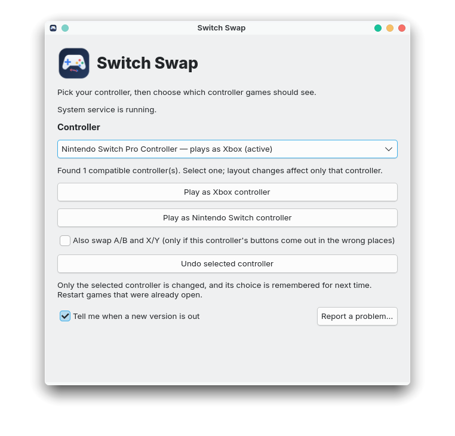
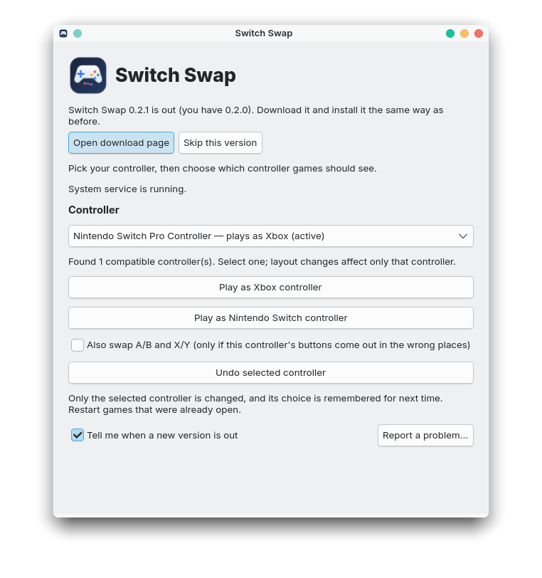

# Switch Swap

<p align="center">
  
</p>

**Make any game controller play as an Xbox controller (or a Switch Pro Controller) in every game on Linux.**

Plug in a Nintendo Switch Pro Controller, an 8BitDo, a PlayStation pad or almost anything else, pick it in Switch Swap, and choose **Play as Xbox controller**. From then on, every game sees a standard wired Xbox 360 controller: Xbox button prompts, the confirm button where Xbox games expect it, triggers that work as triggers, and rumble that still reaches your hands. Your choice is remembered for that controller, over USB and Bluetooth, after every reboot.

<p align="center">
  
</p>

## Install

Download the file for your system from the [latest release](https://github.com/sweatshopking/switch-swap/releases/latest). Most PCs need the **x86_64 / amd64** file; Raspberry Pi and other ARM computers need **aarch64 / arm64**.

| Your system | File | How to install |
| --- | --- | --- |
| Ubuntu, Linux Mint, Debian, Pop!_OS, Zorin | `.deb` | Double-click it, or run `sudo apt install ./switch-swap_*.deb` |
| Fedora, Nobara, openSUSE | `.rpm` | Double-click it, or run `sudo dnf install ./switch-swap-*.rpm` (openSUSE: `sudo zypper install ./switch-swap-*.rpm`) |
| Anything else (Arch, CachyOS, EndeavourOS, Manjaro, …) | `.AppImage` | Make it executable (right-click → Properties → *Allow executing*), open it, and click **Install or update system service** |

The `.deb` and `.rpm` set everything up during installation. Afterwards, open **Switch Swap** from your app menu.

### SteamOS, Bazzite and other systems with a read-only core

These systems lock their system folders, so the usual packages can't be installed normally. Use the **AppImage** instead; its installer puts the service in a folder these systems keep writable and survives system updates.

- **Steam Deck / SteamOS:** switch to Desktop Mode. The installer asks for your password, and the `deck` user has none until you set one: open Konsole and run `passwd` once. Then open the AppImage and click **Install or update system service**. SteamOS's read-only system means no app-menu entry is added; open the AppImage from where you saved it (or add it to Steam as a non-Steam game). Steam's own controller settings in Game Mode still apply on top, so if Steam Input is set to remap the controller, games see Steam's version of it.
- **Bazzite, Fedora Silverblue / Kinoite, Aurora, Bluefin:** the AppImage works as above. Alternatively, layer the `.rpm` with `rpm-ostree install ./switch-swap-*.rpm` and reboot.
- **NixOS:** not supported by these packages; build from source.
- **Systems without systemd** (Void, Alpine, Gentoo with OpenRC, Devuan, antiX): not supported. The background service is a systemd service.

These systems are less tested than the mainstream ones; if something goes wrong, please [report it](#reporting-a-problem).

## Use it

1. Connect your controller (USB or Bluetooth).
2. Open Switch Swap and pick the controller in the list.
3. Click **Play as Xbox controller**. Enter your password when asked.
4. Restart any game (and Steam) that was already open.

That's it. Buttons keep their physical positions, so the bottom face button is always the Xbox **A** (confirm) button, whatever letter is printed on it.

- **Play as Nintendo Switch controller** does the opposite: games see a Switch Pro Controller.
- **Also swap A/B and X/Y** is only for the rare controller whose buttons still come out in the wrong places. Most controllers never need it.
- **Undo selected controller** gives the controller back to games exactly as it was.

Each controller is set separately, up to four at once. Others you plug in are left alone.

## What games see

| | Before | With "Play as Xbox controller" |
| --- | --- | --- |
| Controller name | Your controller's own | Microsoft X-Box 360 pad |
| Button prompts | Often Switch or generic | Xbox |
| Bottom face button | Varies by game | A (confirm) |
| ZL / ZR on a Switch-style pad | Buttons | Full trigger pulls |
| Rumble | ✓ | ✓ passed through to your controller |
| Number of controllers | 1 | 1 (the original is hidden from games) |

Switch Swap works with anything that reads controllers the usual Linux way: Steam and Proton games, Heroic, Lutris, Bottles, native Linux games and emulators.

**Not passed through:** motion controls (gyro), controller lights, and buttons an Xbox controller doesn't have (such as Capture). Switch emulators may want **Undo** so their own Switch controls apply.

## Updates

Switch Swap tells you when a new version is out (you can turn this off at the bottom of the window). Download it and install it the same way as before. AppImage users then click **Update system service**, which the window offers when it's needed.

<p align="center">
  
</p>

## Requirements

- A Linux distribution with **systemd** (almost all of them: Ubuntu 22.04 or newer, Debian 12+, Fedora 41+, openSUSE, Arch, and their relatives). For SteamOS, Bazzite and similar, see [above](#steamos-bazzite-and-other-systems-with-a-read-only-core).
- A desktop with a password prompt for administrator tasks (polkit), which every mainstream desktop has.
- Your controller must show up to Linux as a game controller. Almost every controller does; if yours doesn't appear in the list, Switch Swap shows what it found instead, which helps when asking for help.

## Troubleshooting

**My controller isn't in the list.** Unplug it and plug it back in, or reconnect it over Bluetooth. Controllers that are paired but not working at the Linux level (no driver) can't be changed by any app; the window lists devices it found that don't look like controllers, with the reason.

**A game still shows the old controller.** Restart the game, and Steam, fully. Programs that had the controller open before you chose a layout keep their old view of it until they restart.

**Buttons are swapped the wrong way.** Tick **Also swap A/B and X/Y** and click your choice again.

**Something else?** See below.

## Reporting a problem

1. Open Switch Swap and click **Report a problem…** at the bottom right. It copies a bug report and opens the [problem form](https://github.com/sweatshopking/switch-swap/issues/new?template=bug_report.yml) in your browser.
2. Fill in what happened, what you expected, your controller and the game.
3. Paste the bug report into the last box and submit.

If the window won't open, get the same report from a terminal and paste what it prints:

```sh
switch-swap report                         # .deb or .rpm
./Switch-Swap-*.AppImage report            # AppImage, from the folder it's in
```

The report contains the app version, your distribution and kernel, whether the service is running, the controllers Linux sees, Switch Swap's hiding rules, its recent log, and recent kernel messages about controllers. MAC addresses are masked (`E4:17:D8:xx:xx:xx`). Nothing is sent anywhere: you see all of it before you paste it.

If the service log in the report is empty, your account may not be allowed to read system logs; add it with `sudo journalctl -u switch-swap -n 60 --no-pager` and paste that too.

## Uninstall

- `.deb`: `sudo apt remove switch-swap`
- `.rpm`: `sudo dnf remove switch-swap` (openSUSE: `sudo zypper remove switch-swap`)
- AppImage: run

  ```sh
  sudo systemctl disable --now switch-swap.service
  sudo rm -rf /opt/switch-swap /var/lib/switch-swap /etc/switch-swap /etc/systemd/system/switch-swap.service /etc/systemd/system/switch-swap.service.d \
      /usr/local/share/applications/io.github.switchswap.SwitchSwap.desktop \
      /usr/local/share/icons/hicolor/scalable/apps/io.github.switchswap.SwitchSwap*.svg
  sudo systemctl daemon-reload
  ```

Stopping the service always gives every controller back to games first.

## How it works

A small system service (`switch-swap.service`) watches for controllers. For each one you set, it:

1. creates a virtual controller through Linux's uinput that is an exact copy of the target: a wired Xbox 360 pad as the kernel's `xpad` driver creates it (045e:028e), or a Switch Pro Controller as `hid-nintendo` creates it (057e:2009), with the same buttons, axes and ranges;
2. translates your controller's input into it: buttons keep their positions as the Linux gamepad standard defines them, digital ZL/ZR become full trigger pulls and analog triggers become ZL/ZR presses, D-pad buttons become a D-pad hat, and stick ranges are rescaled;
3. passes rumble from games back to your controller;
4. hides the original controller from games with a udev rule, so games see only one controller. The service itself keeps reading it. Virtual controllers (Steam Input's, other tools', Switch Swap's own) are never hidden.

Controllers are recognised by vendor and product ID plus their MAC address or serial number (or their name if they report neither), so a controller keeps its setting over USB and Bluetooth. Two identical controllers that report no serial number share one setting. Settings are kept in `/etc/switch-swap/settings.conf`; the hiding rule lives in `/etc/udev/rules.d/69-switch-swap-isolation.rules` and is removed whenever the service stops.

Anyone can see the status; changing a controller needs administrator approval (through `pkexec`).

## Building from source

You need Rust 1.92 or newer and the GTK 4 development files (`libgtk-4-dev` on Debian/Ubuntu, `gtk4-devel` on Fedora, `gtk4` on Arch).

```sh
cargo test
cargo build --release
sudo ./install.sh   # installs the binary, service, menu entry and icons
```

`cargo test -- --include-ignored` also runs the end-to-end tests against the kernel, which need write access to `/dev/uinput`.

Release packages are built on the oldest supported systems (Ubuntu 22.04 and Fedora 41) so they run on everything newer: `packaging/build-in-containers.sh` builds them locally with podman or docker, exactly as the GitHub workflow does.

## License

Switch Swap is free software under the [GNU General Public License v3.0 or later](LICENSE).

Not made by or affiliated with Nintendo or Microsoft. Xbox and Nintendo Switch are trademarks of their owners.
